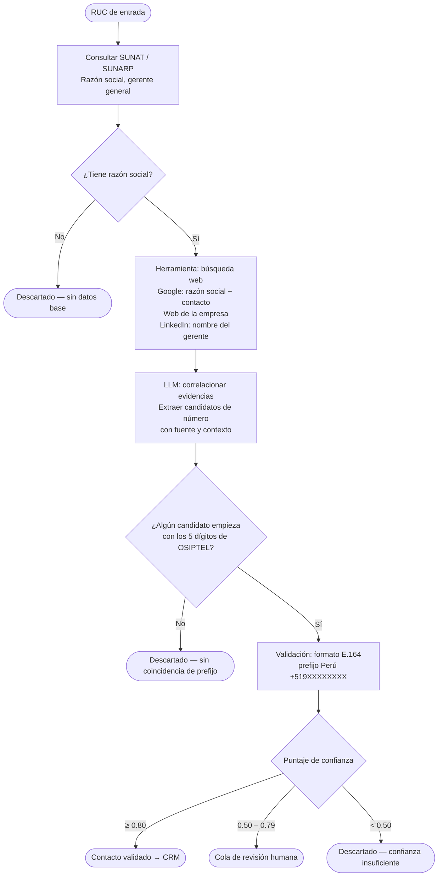

# Parte 3 — Diseño del agente de enriquecimiento

## 1. Arquitectura

**Flujo resumido:** el agente recibe un RUC, consulta las fuentes públicas para obtener contexto (nombre de empresa y gerente), ejecuta búsquedas web dirigidas, le pasa los fragmentos al LLM para que extraiga candidatos de número, y luego valida que el candidato sea compatible con el prefijo parcial conocido de OSIPTEL antes de asignarle un nivel de confianza.

---

## 2. Harness del agente

| Componente | Decisión y justificación |
|---|---|
| **Herramientas disponibles** | (1) `buscar_web(query, n=5)` — Google Custom Search API, máx. 8 llamadas por empresa. (2) `obtener_pagina(url)` — descarga y limpia el HTML de la web corporativa. (3) `buscar_linkedin(nombre_empresa, nombre_gerente)` — Proxycurl o Apollo.io, 1 llamada por empresa. Límite de herramientas por empresa: 10 llamadas en total para controlar costo. |
| **Contexto al LLM** | System prompt fijo con la tarea y las reglas de validación. User message: RUC, razón social, nombre del gerente si existe, prefijo conocido (`98765`), y los fragmentos de texto de cada herramienta (máx. 400 tokens por fragmento). |
| **Esquema de salida** | JSON estructurado: `{ "numero": "+51987654321", "fuente": "web de la empresa", "cita": "texto exacto donde aparece el número", "confianza": 0.85 }`. Si no encuentra, devuelve `{ "numero": null, "motivo": "..." }`. |
| **Validación de respuesta** | Pydantic valida el schema antes de continuar. Si el número no tiene formato E.164 o no empieza con `+519`, se descarta aunque el LLM lo proponga. Se compara el prefijo con los 5 dígitos de OSIPTEL; sin coincidencia → descarte automático. |
| **Presupuesto de intentos** | 1 intento de enriquecimiento por empresa. Si falla por error de API, se reintenta 1 vez con backoff. No se hacen más búsquedas si las primeras 10 llamadas no producen candidatos válidos. |
| **Ausencia de evidencia** | Si LLM retorna `null` o confianza < 0.5, el registro queda como `no_encontrado` en la base. Los casos con confianza 0.5–0.79 van a una cola de revisión humana (Airtable o hoja de Sheets). Los errores de API quedan como `error_tecnico` para reintento diferido. |

---

## 3. Validación y confianza

Un número **no es válido** solo porque tenga formato correcto o el prefijo coincida. La confianza se construye con evidencia:

| Criterio | Puntos |
|---|---|
| Prefijo coincide con los 5 dígitos de OSIPTEL | +0.40 (obligatorio; sin esto la confianza es 0) |
| Número aparece en la web oficial de la empresa (mismo dominio que el RUC) | +0.30 |
| Número aparece en el perfil de LinkedIn de la empresa o del gerente | +0.20 |
| Número aparece en más de una fuente independiente | +0.15 |
| La cita incluye el nombre de la empresa o del gerente junto al número | +0.10 |
| El número fue encontrado en un directorio genérico sin contexto de empresa | −0.20 |

**Umbral de acción:** ≥ 0.80 → validado automáticamente. 0.50–0.79 → revisión humana. < 0.50 → descarte.

La revisión humana solo recibe los casos con evidencia débil pero plausible; no se le pide que busque desde cero.

---

## 4. Diagnóstico del baseline (5%)

500 empresas procesadas → 25 contactos válidos. Tres hipótesis:

| # | Hipótesis | Cómo comprobarla | Evidencia que la confirmaría o descartaría |
|---|---|---|---|
| H1 | **El agente busca el número personal del gerente, no el número corporativo de la empresa.** OSIPTEL registra líneas activas de la empresa, pero las búsquedas están orientadas al gerente como persona natural. | Revisar los prompts y el log de los 25 éxitos: ¿el número encontrado es el móvil personal del gerente o el número de la empresa? | Si el 80% de los éxitos son móviles personales del gerente, la hipótesis se confirma. Si son líneas corporativas, se descarta. |
| H2 | **El universo está sesgado hacia pymes sin presencia digital.** Las empresas de OSIPTEL son en su mayoría pequeños negocios peruanos que no tienen web propia ni aparecen en Google con un número público. | Cruzar las 500 empresas con su tamaño (número de RUC de trabajadores en T-Registro) y verificar qué porcentaje tiene web indexada. | Si el 70%+ de las empresas procesadas no tiene web ni LinkedIn, la tasa del 5% es el techo real del canal de búsqueda web. |
| H3 | **El LLM no usa el prefijo parcial de OSIPTEL como filtro duro.** Encuentra números pero no los descarta cuando el prefijo no coincide, o descarta buenos candidatos por error de interpretación. | Revisar los logs del LLM para los 475 casos fallidos: ¿encontró algún candidato que el post-procesamiento descartó por prefijo? ¿O el LLM directamente devolvió `null`? | Si hay candidatos descartados en el post-proceso con prefijo coincidente, el bug está en el schema de salida o la validación. Si el LLM siempre devuelve `null`, el problema es de cobertura de búsqueda. |

---

## 5. Costos

Presupuesto aprobado: **US$1,000 total (desarrollo + operación)**.

Tarifas de referencia (nov 2026):

| Componente | Tarifa | Uso por empresa | Costo |
|---|---|---|---|
| Google Custom Search API | $5 / 1,000 queries | 6 queries | $0.030 |
| Proxycurl (LinkedIn lookup) | $0.010 / perfil | 1 perfil | $0.010 |
| Claude Haiku 3 (input) | $0.80 / M tokens | ~4,000 tokens | $0.003 |
| Claude Haiku 3 (output) | $4.00 / M tokens | ~400 tokens | $0.002 |
| **Total por empresa** | | | **~$0.045** |

Supuesto de desarrollo: 3 días de un desarrollador reutilizando el stack de scraping existente → **$300**.

Presupuesto operativo restante: $700.

**Empresas procesables: `$700 / $0.045 ≈ 15,500 empresas`.**

Nota: si la H2 se confirma y la mitad de las empresas no tiene presencia digital, conviene agregar un filtro previo barato (¿tiene web indexada?) que descarte esas empresas antes de consumir el presupuesto de búsqueda y LLM. Eso podría reducir el costo efectivo a ~$0.025/empresa y extender el alcance a ~28,000 empresas con el mismo presupuesto.

---

## 6. Métricas

| Métrica | Qué mide | Meta inicial |
|---|---|---|
| **Tasa de cobertura** | Empresas con al menos un candidato encontrado / total procesadas | > 30% (vs. 5% actual) |
| **Tasa de precisión** | Contactos validados automáticamente que son correctos al llamar / total validados | > 70% |
| **Costo por contacto validado** | Presupuesto operativo / contactos validados | < $0.50 |
| **Tasa de revisión humana** | Casos en cola 0.50–0.79 / total procesados | < 15% (para que la revisión sea manejable) |
| **Tasa de error técnico** | Fallos de API, timeouts / total procesados | < 2% |

La comparación contra el baseline debe hacerse sobre la misma muestra de 500 empresas con el mismo criterio de validez, no sobre una muestra nueva.

---

## Riesgos legales o de cumplimiento

En Perú, la Ley N.° 29733 (Protección de Datos Personales) aplica al tratamiento de datos de personas naturales, incluidos los gerentes. Aunque los datos de la empresa (RUC, razón social) son públicos por SUNAT, el número móvil del gerente general es un dato personal y su tratamiento requiere base legal (consentimiento o interés legítimo debidamente documentado). El scraping de LinkedIn puede violar sus Términos de Servicio y exponer a 1Forge a reclamos contractuales. Se recomienda limitar el enriquecimiento a fuentes abiertas (web corporativa, directorios empresariales públicos) y registrar el origen de cada dato antes de incorporarlo al CRM.
